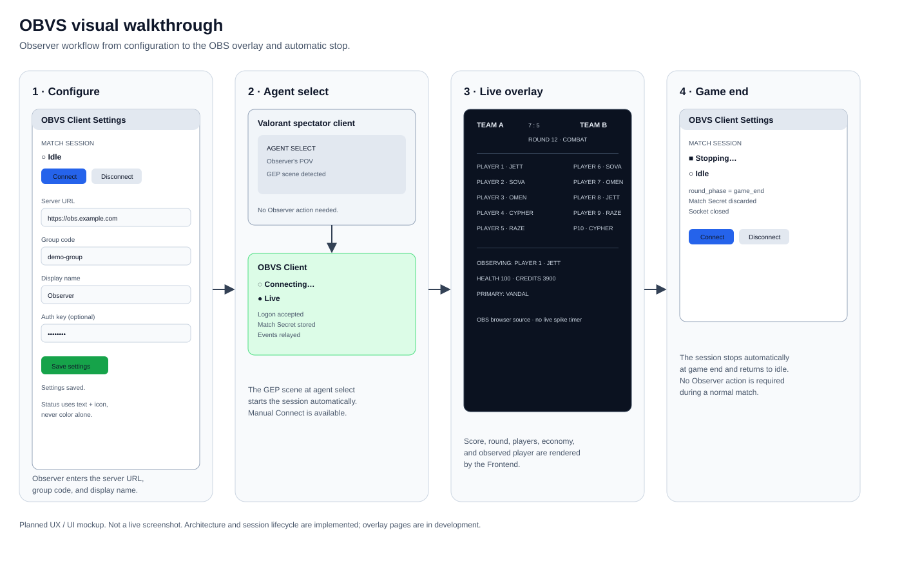
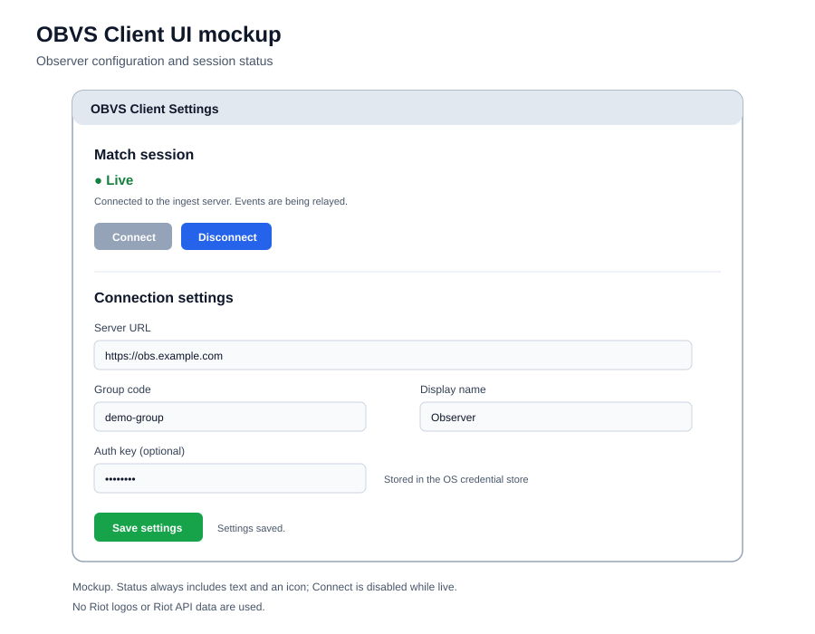
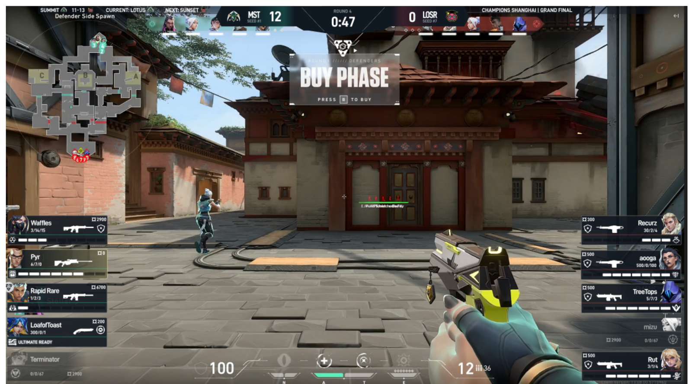
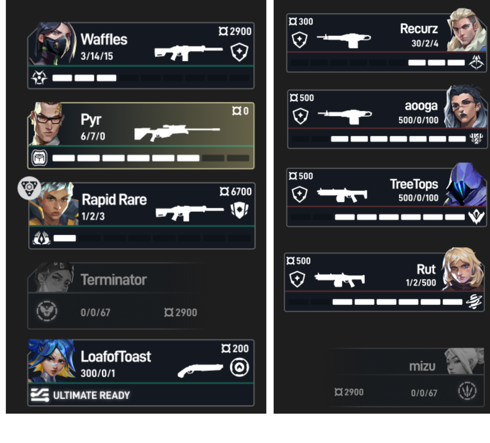
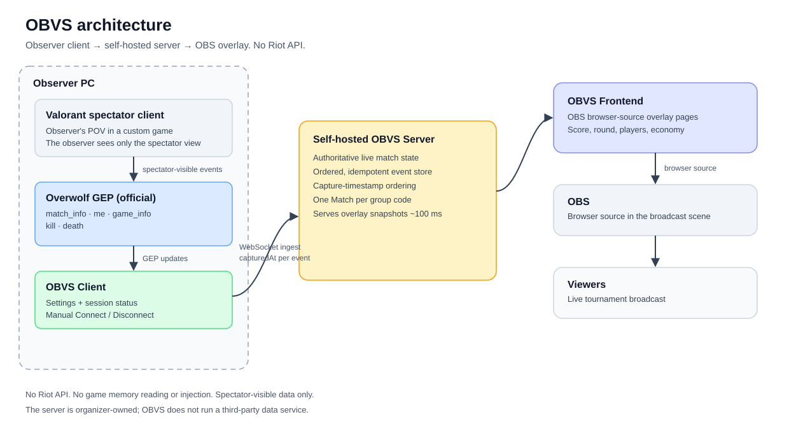
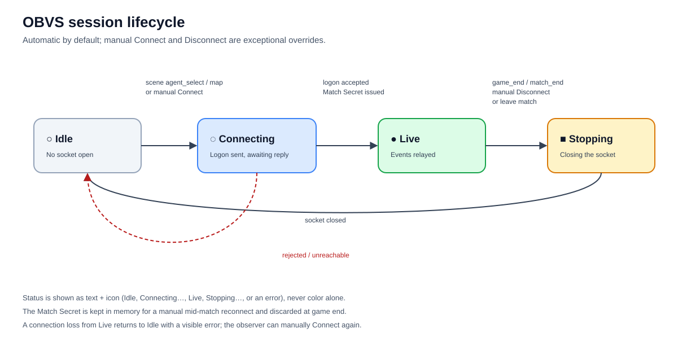
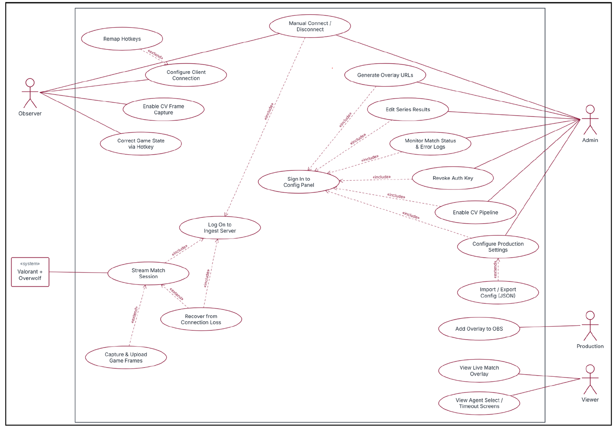
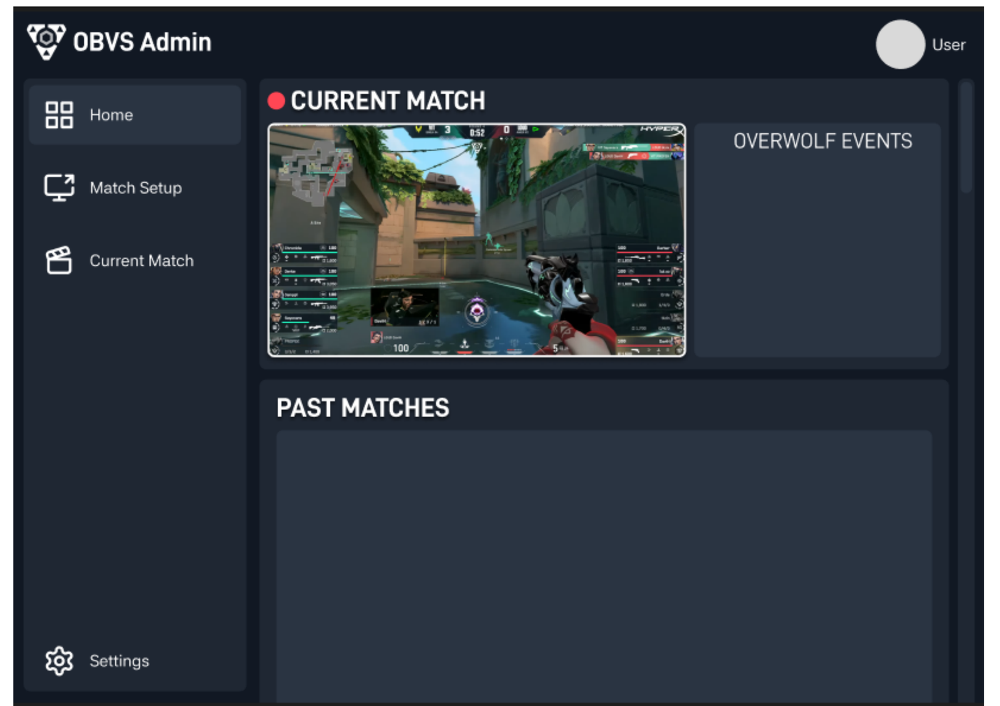

# OBVS

**Open Broadcasting Valorant Software** — a free tournament broadcast overlay for Valorant community tournaments.

OBVS is a Windows desktop application for tournament observers and broadcasters. It captures spectator-visible match data through Overwolf's official Game Events Provider (GEP), relays it to the organizer's self-hosted server, and renders OBS browser-source overlays for viewers. Any community tournament organizer can self-host it. It is maintained by the Five-Guy5 team and was first deployed by the Missouri S&T Esports Club.

This page is the public product walkthrough for review. No login, Discord account, or application download is required to review the visual flow.

## At a glance

| | |
|---|---|
| **Product** | OBVS — Open Broadcasting Valorant Software |
| **Platform** | Windows 10/11 desktop app (observer client) + self-hosted server + OBS overlay pages |
| **Users** | Tournament organizers, observers, and broadcast production teams |
| **Data source** | Overwolf Game Events Provider (GEP): `match_info`, `me`, `game_info`, `kill`, `death` |
| **Riot API** | Not used. No Riot API key, no RSO login, no Riot-sourced player data |
| **Player data** | Live spectator-visible match data only; no match history, no persistent player information |
| **Monetization** | Free. No paid tiers, subscriptions, or exclusive-access features |
| **Status** | Observer session and ingest are implemented; overlay pages are in active development. UI mockups below are labeled. |

## Visual walkthrough

1. **Configure** — the observer enters the server URL, group code, and display name in the OBVS Client.
2. **Agent select** — the Client detects the match scene and connects automatically. No observer action is needed.
3. **Live overlay** — the self-hosted OBVS server keeps the live match state and the Frontend renders OBS browser-source overlays for viewers.
4. **Game end** — at `round_phase = game_end`, the Client stops automatically and returns to idle.

<!-- Optional: add a public 60-90 second walkthrough video link here before submission. The diagrams above already provide the visual flow. -->

The architecture, visual flow, and session lifecycle diagrams reflect the current product. The Client settings mockup is a current UI mockup; the use-case diagram and overlay/admin UI demos are from the team's CS4090 Midterm Project Documentation.

### Client UI mockup

The Client is the observer's only desktop surface: connection settings, a text-and-icon session status, and manual Connect/Disconnect controls.

### Overlay UI demos

The Frontend is a set of OBS browser-source pages. UI Demo #1 shows the live overlay over gameplay; UI Demo #2 shows the player cards at enhanced resolution. Both are from the project's CS4090 midterm documentation. They show spectator-visible match information: team scores, round state, player panels, economy, ultimate points, loadout, and the currently observed player. They do not show a live spike timer.

## How it works

1. The observer runs the OBVS Client on the spectator PC alongside the Valorant spectator client.
2. Overwolf GEP delivers spectator-visible game events to the Client.
3. The Client relays every update to the organizer's self-hosted OBVS Server with a capture timestamp.
4. The Server maintains the authoritative live match state and serves the Frontend.
5. The Frontend renders OBS browser-source overlays for the broadcast.

There is no Riot API call, no game memory reading, no game-process injection, no input automation, and no hidden information. The observer sees the same spectator view as a human observer; OBVS only organizes and relays that view for the broadcast.

### Session lifecycle

The session is a small state machine:

- **Idle → Connecting** — triggered by the GEP scene entering agent select or a map, or by manual Connect.
- **Connecting → Live** — the server accepts the logon and returns the Match Secret.
- **Live → Stopping** — triggered by `round_phase = game_end`, the `match_end` event, manual Disconnect, or an automatic session leaving the match.
- **Stopping → Idle** — the socket closes.
- **Failure paths** — a rejected logon or unreachable server returns to Idle with a text error; an unexpected connection loss returns to Idle with a text error.

The status indicator uses text and an icon (Idle, Connecting…, Live, Stopping…, error) and never relies on color alone. The Match Secret is kept in memory for a manual mid-match reconnect and discarded at game end.

## Use case overview

This use-case diagram is from the CS4090 midterm documentation. It covers the observer, admin, production, and viewer workflows. The CV frame-capture and CV-pipeline use cases are optional and disabled by default; this approval covers the GEP-only observer/overlay build. The Config Panel is a planned admin surface.

### Config panel mockup (planned)

UI Demo #3 shows the planned admin/config panel from the CS4090 documentation: current match status, Overwolf event monitoring, and past matches. It is not part of the current GEP-only build.

## Features

- Automatic session start at agent select; automatic stop at game end.
- Manual Connect and Disconnect for exceptional cases.
- Every GEP update is relayed with a capture timestamp; the raw feed is preserved alongside typed lifecycle events.
- Self-hosted server with an ordered, idempotent event store.
- OBS-ready overlay pages for score, round, players, economy, and observed player.
- Text-and-icon connection status with visible error reasons.
- No player installs; the observer's client is the only capture point.

## Riot compliance

| Riot acknowledgement | OBVS position |
|---|---|
| Read the VALORANT game documentation and understand the requirements | Read and acknowledged. |
| Not for personal, educational, testing, or small-group use | OBVS is a public tool for any community tournament organizer, not limited to one club, class, or private group. |
| Not a VALORANT item store checker | OBVS is a broadcast overlay. It does not check or display store items. |
| The VALORANT API does not provide real-time or professional esports data | Understood. OBVS uses Overwolf GEP for live spectator data and does not use the VALORANT API for live data. |
| No player info or match history/stats without OAuth (RSO) | OBVS does not use the Riot API, does not collect or persist player information, and does not show match history. It displays only live, spectator-visible data from GEP. We have asked Riot to confirm whether RSO applies to this GEP-only use case and will comply with Riot's determination. |
| Working prototype or visual flow | The visual flow, UI mockups, architecture, and lifecycle diagrams on this page demonstrate the intended end-to-end UX. |
| Public view settings; no external app download, account creation, or Discord required | This page is public. The visual flow requires no login, no Discord, and no app download. |
| No Riot logos or claims of Riot endorsement | OBVS uses no Riot logos and claims no Riot endorsement. |

## Riot API and RSO

OBVS does not call Riot API endpoints and does not request a Riot API key. Live match data arrives through Overwolf's official Game Events Provider, which exposes only information already visible to the spectator. The app does not read game memory, modify the game, inject code, automate input, or reveal hidden information.

OBVS is seeking Riot's third-party product approval because Overwolf requires Riot approval for any Valorant-related application, even when the app does not use the Riot API.

Because OBVS does not use Riot API player data, the current build does not implement RSO. We understand that RSO is required for approved VALORANT applications that display Riot-sourced player stats or match history, and we have asked Riot to confirm whether the requirement applies to this GEP-only spectator use case. If Riot determines that RSO applies, we will implement it before release.

## Availability and monetization

OBVS is free for all tournament participants and viewers. There are no paid tiers, subscriptions, or exclusive-access features. The project does not include betting, wagering, alternate rankings, MMR/ELO calculations, player shaming, or live spike timers.

## Source and contact

- Source code: https://github.com/Five-Guy5/OBVS
- Product site: https://five-guy5.github.io/OBVS/
- Contact: https://github.com/Five-Guy5/OBVS/issues

---

OBVS isn't endorsed by Riot Games and doesn't reflect the views or opinions of Riot Games or anyone officially involved in producing or managing Riot Games properties. Riot Games and all associated properties are trademarks or registered trademarks of Riot Games, Inc.
